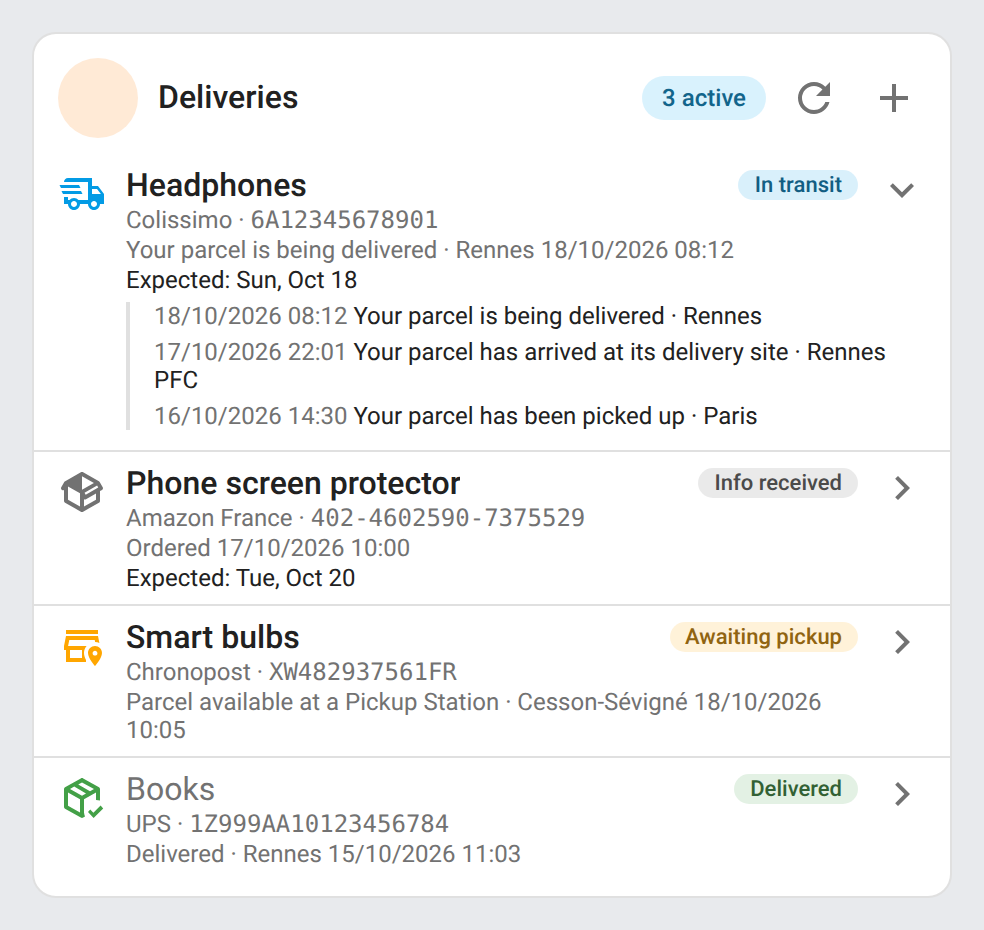
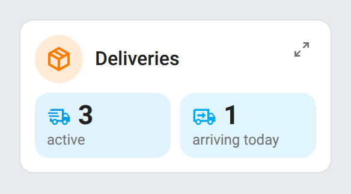
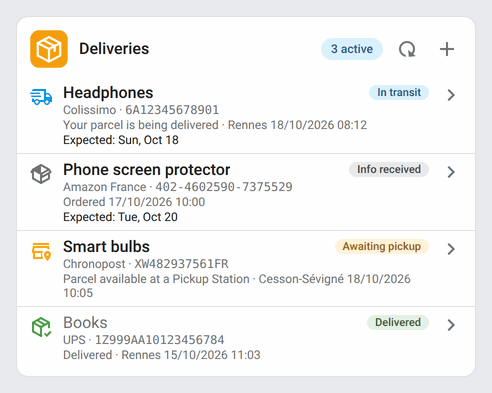
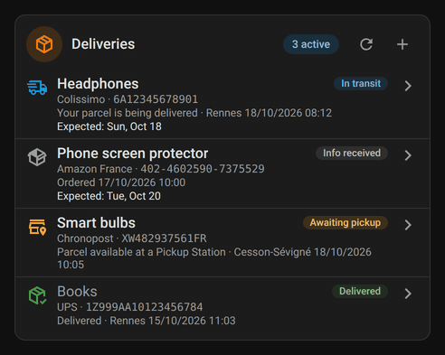
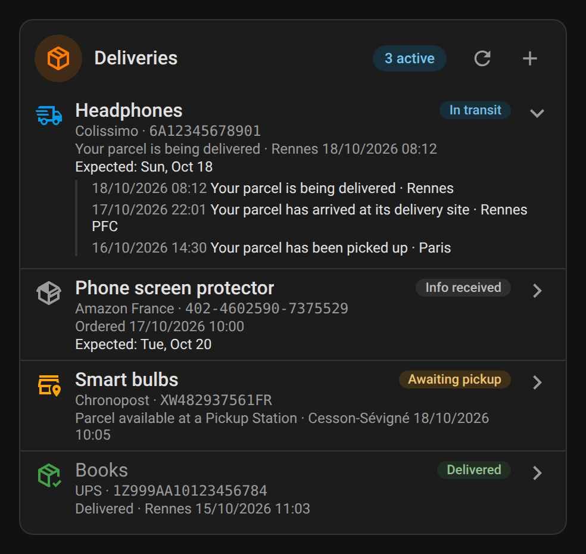
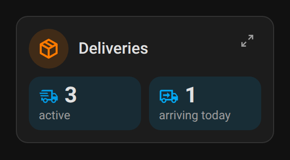

# ha-parcel

[](https://www.home-assistant.io/integrations/marketplace/)
[](https://github.com/juju35/ha-parcel/actions/workflows/hacs.yml)
[](https://github.com/juju35/ha-parcel/actions/workflows/validate.yml)
[](https://github.com/juju35/ha-parcel/actions/workflows/lint.yml)
[](https://github.com/juju35/ha-parcel/releases/latest)
[](https://github.com/juju35/ha-parcel/blob/main/LICENSE)
[](https://buymeacoffee.com/julienstep9)

Home Assistant integration for [Parcel](https://parcelapp.net): see the deliveries tracked in Parcel and add new ones, with a Lovelace card included.

[](https://my.home-assistant.io/redirect/marketplace_repository/?owner=juju35&repository=ha-parcel&category=integration)



## Features

- **Deliveries** sensor: number of active deliveries, with every delivery (status, carrier, events, expected date) as attributes
- **Deliveries** calendar: one event per active delivery on its expected date
- `parcel.add_delivery` action to add a delivery from an automation, a script or the card
- `parcel.refresh` action to force an update
- `custom:parcel-card` card, **shipped with the integration** and loaded automatically: list of deliveries, events on click, add form with carrier search
- `custom:parcel-mini-card` compact card: active deliveries and deliveries arriving today, with a button to open the full card
- `parcel_out_for_delivery` and `parcel_delivered` events when a delivery changes status, for automations
- Diagnostics download with the API key, tracking numbers, addresses and emails redacted
- API key entered in the UI, never in YAML
- English, French, German, Spanish, Serbian (Cyrillic and Latin), Italian, Dutch, Portuguese, Polish, Romanian, Danish, Swedish, Bulgarian, Russian, Ukrainian, Hungarian, Slovak, Czech, Slovenian, Latvian and Greek

## Prerequisites

- Home Assistant 2024.12 or later
- A **Parcel Premium** subscription (the API is reserved to it)
- An API key, generated on [web.parcelapp.net](https://web.parcelapp.net)

## Installation

### Via the Marketplace (recommended)

Click the button below to add the repository directly:

[](https://my.home-assistant.io/redirect/marketplace_repository/?owner=juju35&repository=ha-parcel&category=integration)

Then click **Install** and restart Home Assistant.

Or manually:

1. Open **Settings → Marketplace → Add from link** (top right; this needs a GitHub account connected)
2. Add `https://github.com/juju35/ha-parcel` — Type: **Integration**
3. Open **Parcel** and click **Install**
4. Restart Home Assistant

The card is **part of the integration**: at startup it is added to the dashboard resources (`/parcel_static/parcel-card.js`, module). After an install or an update, restart Home Assistant and refresh the browser (clear the companion app cache if needed).

If your dashboards are in YAML mode, the card is loaded on every page without going through the resources.

### Manual

Copy `custom_components/parcel/` to `/config/custom_components/parcel/`, then restart Home Assistant.

## Configuration

### Integration

[](https://my.home-assistant.io/redirect/config_flow_start/?domain=parcel)

**Settings → Devices & services → Add integration → Parcel**, then paste your API key.

Options (**Configure** button):

| Option | Default | Description |
|---|---|---|
| Deliveries to show | Recent | `recent`: active and recently delivered. `active`: active only |
| Update interval | 10 min | Minimum 5 min: Parcel limits the API to 20 requests per hour |

### Card

Add the **Parcel** card from the card picker: every option is set in the visual editor. In YAML:

```yaml
type: custom:parcel-card
```

| Option | Default | Description |
|---|---|---|
| `entity` | detected | Parcel sensor to show (useful with several accounts) |
| `title` | `Deliveries` | Card title |
| `show_delivered` | `true` | Show delivered parcels |
| `show_add` | `true` | Show the add button |
| `show_refresh` | `true` | Show the refresh button (counts towards the 20 requests per hour) |
| `max_events` | `5` | Number of events shown when a delivery is expanded |
| `language` | Auto | Force language: `en`, `fr`, `de`, `es`, `sr`, `sr-Latn`, `it`, `nl`, `pt`, `pl`, `ro`, `da`, `sv`, `bg`, `ru`, `uk`, `hu`, `sk`, `cs`, `sl`, `lv` or `el` (auto-detects from HA settings) |

Click a delivery to see its events, and the tracking number to copy it.

### Mini card

A compact card for dashboards: the number of active deliveries and of deliveries arriving today (out for delivery, or expected today). The button at the top right opens the full card in place; a click outside the card folds it back.

```yaml
type: custom:parcel-mini-card
```

It takes the same options as `custom:parcel-card` (set in the same visual editor); `show_delivered`, `show_add`, `show_refresh` and `max_events` apply to the full view.



### Adding a delivery from an automation

```yaml
action: parcel.add_delivery
data:
  tracking_number: "6A12345678901"
  carrier_code: colissimo
  description: Headphones
  send_push_confirmation: true
```

Carrier codes are listed in [supported_carriers.json](https://api.parcel.app/external/supported_carriers.json). Use `pholder` for a delivery without tracking.

> Parcel limits additions to **20 per day**, failures included. A new delivery shows up after Parcel's next update.

`parcel.add_delivery` is reserved to administrators (the card hides its add button from other users); `parcel.refresh` is open to every user. Service errors are translated in the Home Assistant language.

### Events

The integration fires an event on the Home Assistant event bus when a delivery changes status between two updates:

| Event | When |
|---|---|
| `parcel_out_for_delivery` | A delivery is now out for delivery |
| `parcel_delivered` | A delivery is now delivered |

Event data: `config_entry_id`, `carrier_code`, `carrier` (carrier name), `name` (the delivery description) and `tracking_id`, a stable short hash of the carrier and tracking number (the same for both events of a delivery). The tracking number itself is left out, since events are stored in the recorder and the logbook.

Nothing fires at startup, after a reload or for a delivery seen for the first time. With the **Active** filter, Parcel drops delivered parcels from the list instead of changing their status: there, `parcel_delivered` fires when a delivery that was not yet delivered leaves the list (a delivery deleted in the Parcel app fires it too).

```yaml
triggers:
  - trigger: event
    event_type: parcel_delivered
actions:
  - action: notify.mobile_app_phone
    data:
      title: Parcel delivered
      message: "{{ trigger.event.data.name }} ({{ trigger.event.data.carrier }}) has been delivered."
```

### Calendar

Each account also gets a calendar, `calendar.parcel_deliveries`, with one event per delivery not yet delivered that has an expected date: an all-day event when Parcel gives only a day (over several days for a delivery window), a timed event otherwise (one hour long when Parcel gives no end). The event title is the delivery description, its description the carrier name; the tracking number is left out. Show it in the calendar dashboard or a calendar card, or trigger automations on it:

```yaml
triggers:
  - trigger: calendar
    event: start
    entity_id: calendar.parcel_deliveries
actions:
  - action: notify.mobile_app_phone
    data:
      message: "{{ trigger.calendar_event.summary }} is expected today."
```

### Diagnostics

**Settings → Devices & services → Parcel → ⋮ → Download diagnostics** gives the entry options and the last deliveries, for bug reports. The API key, tracking numbers, event locations, extra carrier information (often a pickup address), postcodes and emails are redacted.

## Screenshots

While parcels refresh, the card animates: the refresh button spins until the update finishes. It settles to a still card once done.

| Light | Dark |
|---|---|
|  |  |

The stills show the card with one delivery expanded to its events.

| Light | Dark |
|---|---|
|  |  |

The mini card, compact:

| Light | Dark |
|---|---|
|  |  |

## How it works

The integration polls the Parcel API at the update interval and exposes the deliveries on one sensor and one calendar per account. When an update fails (hourly request limit reached, timeout, Parcel server error), the sensor keeps the last deliveries until the next update and flags them with its `stale` (`true`) and `last_error` attributes; only a refused API key makes it unavailable. The card reads that sensor, sorts active deliveries first by expected date, and colors each status from the Home Assistant theme:

| Code | Status | Color |
|---|---|---|
| 0 | Delivered | `--success-color` |
| 1 | No updates | disabled |
| 2 | In transit | `--info-color` |
| 3 | Awaiting pickup | `--warning-color` |
| 4 | Out for delivery | `--primary-color` |
| 5 | Not found | disabled |
| 6 | Failed attempt | `--error-color` |
| 7 | Exception | `--error-color` |
| 8 | Info received | secondary text |

## Development

```bash
pip install -r requirements_test.txt && pytest
pip install playwright==1.64.1 && playwright install chromium
python scripts/screenshots.py   # renders the card and mini card stills and the refreshing.gif / refreshing-dark.gif animations (needs ffmpeg) into screenshots/
```

Python tests live in `tests/` (pytest); the card's JavaScript tests live in `test/` (`node --test test/*.test.mjs`).

### Releasing

1. Bump the version in `custom_components/parcel/manifest.json` and `PARCEL_CARD_VERSION` in the card
2. Add a `## <version>` section at the top of [CHANGELOG.md](https://github.com/juju35/ha-parcel/blob/main/CHANGELOG.md)
3. Push to `main`: the **Release** workflow creates the tag and the GitHub release with the changelog section as notes

## Translations

The integration and the card follow the language of Home Assistant (the card's `language` option can force another one). Currently supported:

| Language | Code |
|---|---|
| English | `en` |
| Français | `fr` |
| Deutsch | `de` |
| Español | `es` |
| Српски | `sr` |
| Srpski (latinica) | `sr-Latn` |
| Italiano | `it` |
| Nederlands | `nl` |
| Português (Portugal) | `pt` |
| Polski | `pl` |
| Română | `ro` |
| Dansk | `da` |
| Svenska | `sv` |
| Български | `bg` |
| Русский | `ru` |
| Українська | `uk` |
| Magyar | `hu` |
| Slovenčina | `sk` |
| Čeština | `cs` |
| Slovenščina | `sl` |
| Latviešu | `lv` |
| Ελληνικά | `el` |

Brazilian Portuguese (`pt-BR`): pt-BR uses the European Portuguese texts, in the integration and the card.

Contributions for additional languages are welcome!

## License

[MIT](https://github.com/juju35/ha-parcel/blob/main/LICENSE)

## Support

If you find this project useful, you can support its development:

<a href="https://buymeacoffee.com/julienstep9"></a>
