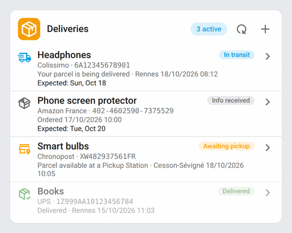
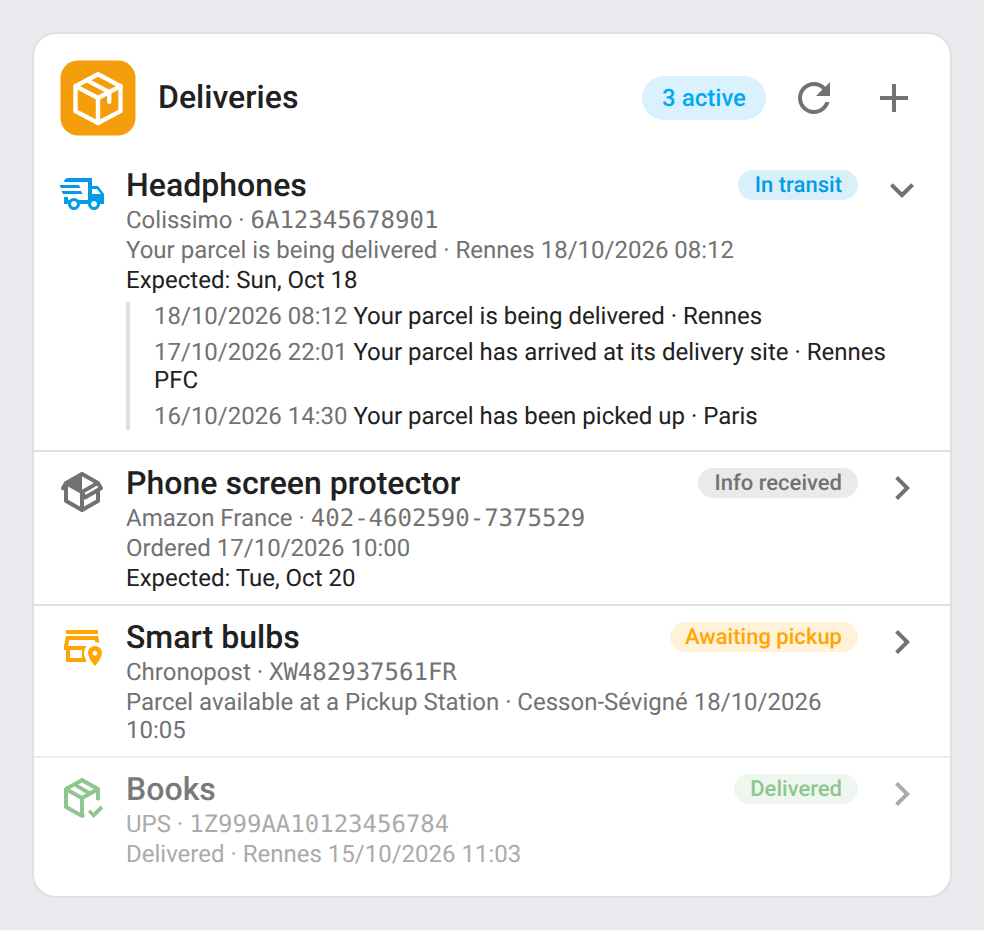
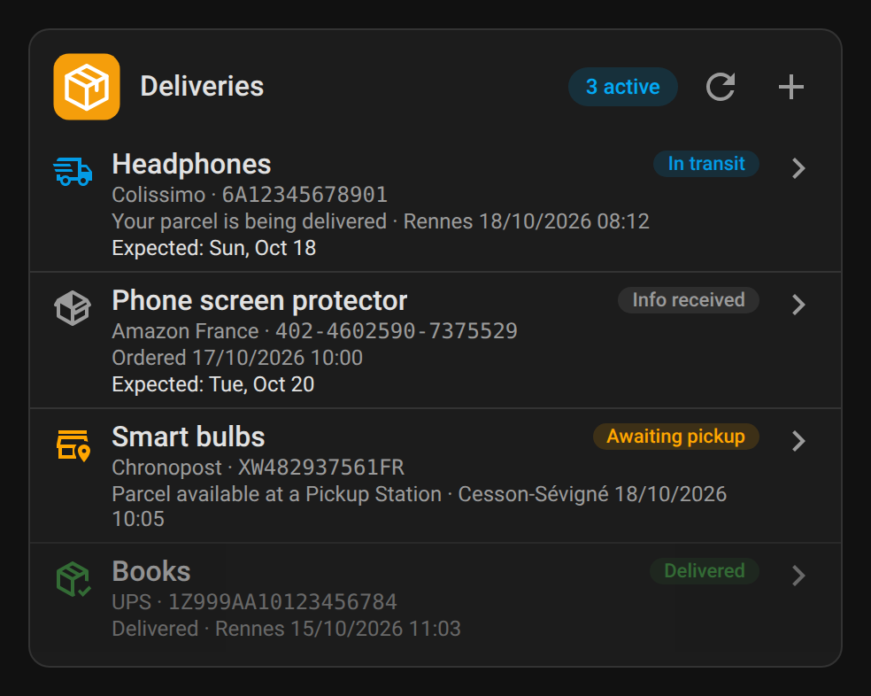

# ha-parcel

[](https://github.com/hacs/integration)
[](https://github.com/juju35/ha-parcel/actions/workflows/hacs.yml)
[](https://github.com/juju35/ha-parcel/actions/workflows/validate.yml)
[](https://github.com/juju35/ha-parcel/releases/latest)
[](LICENSE)

Home Assistant integration for [Parcel](https://parcelapp.net): see the deliveries tracked in Parcel and add new ones, with a Lovelace card included.

[](https://my.home-assistant.io/redirect/hacs_repository/?owner=juju35&repository=ha-parcel&category=integration)


## Features

- **Deliveries** sensor: number of active deliveries, with every delivery (status, carrier, events, expected date) as attributes
- `parcel.add_delivery` action to add a delivery from an automation, a script or the card
- `parcel.refresh` action to force an update
- `custom:parcel-card` card, **shipped with the integration** and loaded automatically: list of deliveries, events on click, add form with carrier search
- API key entered in the UI, never in YAML
- English, French, German and Spanish

## Prerequisites

- Home Assistant 2024.12 or later
- A **Parcel Premium** subscription (the API is reserved to it)
- An API key, generated on [web.parcelapp.net](https://web.parcelapp.net)

## Installation

### Via HACS (recommended)

Click the button below to add the repository directly:

[](https://my.home-assistant.io/redirect/hacs_repository/?owner=juju35&repository=ha-parcel&category=integration)

Then click **Download** and restart Home Assistant.

Or manually:

1. Open HACS → **⋮** (top right) → **Custom repositories**
2. Add `https://github.com/juju35/ha-parcel` — Type: **Integration**
3. Search for **Parcel** and click **Download**
4. Restart Home Assistant

The card is **part of the integration**: at startup it is added to the dashboard resources (`/parcel_static/parcel-card.js`, module). After an install or an update, restart Home Assistant and refresh the browser (clear the companion app cache if needed).

If your dashboards are in YAML mode, the card is loaded on every page without going through the resources.

### Manual

Copy `custom_components/parcel/` to `/config/custom_components/parcel/`, then restart Home Assistant.

## Configuration

### Integration

[](https://my.home-assistant.io/redirect/config_flow_start/?domain=parcel)

**Settings → Devices & services → Add integration → Parcel**, then paste your API key.

Options (**Configure** button):

| Option | Default | Description |
|---|---|---|
| Deliveries to show | Recent | `recent`: active and recently delivered. `active`: active only |
| Update interval | 10 min | Minimum 5 min: Parcel limits the API to 20 requests per hour |

### Card

Add the **Parcel** card from the card picker: every option is set in the visual editor. In YAML:

```yaml
type: custom:parcel-card
```

| Option | Default | Description |
|---|---|---|
| `entity` | detected | Parcel sensor to show (useful with several accounts) |
| `title` | `Deliveries` | Card title |
| `show_icon` | `true` | Show the Parcel icon next to the title |
| `show_delivered` | `true` | Show delivered parcels |
| `show_add` | `true` | Show the add button |
| `show_refresh` | `true` | Show the refresh button (counts towards the 20 requests per hour) |
| `max_events` | `5` | Number of events shown when a delivery is expanded |
| `language` | Auto | Force language: `en`, `fr`, `de` or `es` (auto-detects from HA settings) |

Click a delivery to see its events, and the tracking number to copy it.

### Adding a delivery from an automation

```yaml
action: parcel.add_delivery
data:
  tracking_number: "6A12345678901"
  carrier_code: colissimo
  description: Headphones
  send_push_confirmation: true
```

Carrier codes are listed in [supported_carriers.json](https://api.parcel.app/external/supported_carriers.json). Use `pholder` for a delivery without tracking.

> Parcel limits additions to **20 per day**, failures included. A new delivery shows up after Parcel's next update.

## Screenshots

While parcels refresh, the card animates: the refresh button spins until the update finishes. It settles to a still card once done.



| Light (a delivery expanded) | Dark |
|---|---|
|  |  |

## How it works

The integration polls the Parcel API at the update interval and exposes the deliveries on one sensor per account. The card reads that sensor, sorts active deliveries first by expected date, and colors each status from the Home Assistant theme:

| Code | Status | Color |
|---|---|---|
| 0 | Delivered | `--success-color` |
| 1 | No updates | disabled |
| 2 | In transit | `--info-color` |
| 3 | Awaiting pickup | `--warning-color` |
| 4 | Out for delivery | `--primary-color` |
| 5 | Not found | disabled |
| 6 | Failed attempt | `--error-color` |
| 7 | Exception | `--error-color` |
| 8 | Info received | secondary text |

## Development

```bash
pip install -r requirements_test.txt && pytest
pip install playwright==1.64.1 && playwright install chromium
python scripts/screenshots.py   # renders the card stills and the refreshing.gif animation (needs ffmpeg) into screenshots/
```

Python tests live in `tests/` (pytest); the card's JavaScript tests live in `test/` (`node --test test/`).

### Releasing

1. Bump the version in `custom_components/parcel/manifest.json` and `PARCEL_CARD_VERSION` in the card
2. Add a `## <version>` section at the top of [CHANGELOG.md](CHANGELOG.md)
3. Push to `main`: the **Release** workflow creates the tag and the GitHub release with the changelog section as notes

## Translations

The integration and the card follow the language of Home Assistant (the card's `language` option can force another one). Currently supported:

| Language | Code |
|---|---|
| English | `en` |
| Français | `fr` |
| Deutsch | `de` |
| Español | `es` |

Contributions for additional languages are welcome!

## License

[MIT](LICENSE)
